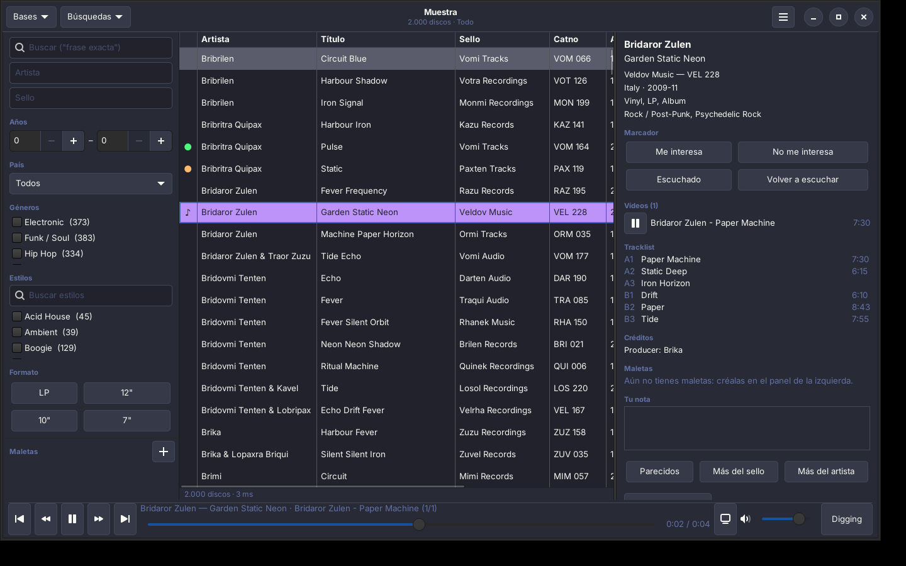

<p align="center">
  
</p>

<h1 align="center">Vault</h1>

<p align="center">
  Explorador de vinilos sobre los dumps de Discogs.<br>
  Rust + GTK4 · minimalista · tema Dracula y nueve más · versión 1.0
</p>



<sub>La captura usa la base de prueba del repositorio, con artistas y sellos inventados.</sub>

## Qué hace

- **Importa una vez** el dump mensual de releases de [data.discogs.com](https://data.discogs.com/)
  a una base local, eligiendo qué entra: formato, géneros → estilos y años.
- **Busca y filtra al instante** entre millones de discos: texto libre, artista, sello, años,
  país, géneros, estilos, formato, con vídeos, por marcador o por maleta.
- **Escucha** los vídeos de YouTube de cada disco con mpv + yt-dlp, solo audio o con una
  ventana de vídeo pequeña.
- **Clasifica** uno a uno con el teclado (modo digging): Me interesa, No me interesa, Escuchado,
  Volver a escuchar.
- **Organiza** en maletas, guarda búsquedas con nombre y exporta a CSV para comprar.
- **Vuelve donde lo dejaste:** filtros, orden y disco se restauran al abrir.

## Instalar

Vault necesita **mpv** y **yt-dlp** del sistema para reproducir:

```bash
sudo pacman -S --needed mpv yt-dlp
```

### AppImage (lo más rápido)

Descarga `Vault-x86_64.AppImage` de la página de versiones del repositorio, o constrúyelo tú
(ver abajo), y:

```bash
chmod +x Vault-x86_64.AppImage
```

```bash
./Vault-x86_64.AppImage
```

Si se queja de FUSE: `sudo pacman -S fuse2`, o lánzalo con `--appimage-extract-and-run`.

### Arch Linux (PKGBUILD)

```bash
cd packaging && makepkg -si
```

Instala `vault`, las herramientas de terminal, el lanzador del escritorio y el icono.

### Desde el código

```bash
sudo pacman -S --needed gtk4 rust
```

```bash
cargo build --release
```

```bash
./target/release/vault
```

Para construir el AppImage: `packaging/build-appimage.sh` (lo deja en `dist/`).

## Empezar en tres pasos

1. Descarga `discogs_AAAAMMDD_releases.xml.gz` de data.discogs.com. Unos 10 GB; no hace falta
   descomprimirlo.
2. En Vault, **Bases → Importar dump…**, con el preajuste **«Todo en vinilo»** o tus propios
   filtros. Tarda unos 8–10 minutos y se puede cancelar.
3. Filtra, elige un disco y pulsa **Espacio** para escucharlo.

Todo lo demás está en el **[manual de usuario](docs/MANUAL.md)**.

## Documentación

| Documento | Para qué |
|---|---|
| [Manual de usuario](docs/MANUAL.md) | Importar, buscar, escuchar, clasificar, maletas, atajos, ajustes |
| [Guía de desarrollo](docs/DESARROLLO.md) | Arquitectura, esquema de la base, tests, herramientas, empaquetado |
| [Cambios](CHANGELOG.md) | Qué trae cada versión |

## Créditos

- **David Gimenez**: director del proyecto.
- **Claude, de Anthropic**: programación.

Gracias a Discogs por publicar sus datos, a los proyectos mpv y yt-dlp, y a Digityzer, de donde
vienen los temas de color.

## Licencia

[MIT](LICENSE) © 2026 David Gimenez.

Vault no está afiliado a Discogs. Los datos de los dumps son de Discogs y se usan según sus
condiciones; los vídeos se reproducen desde YouTube.
