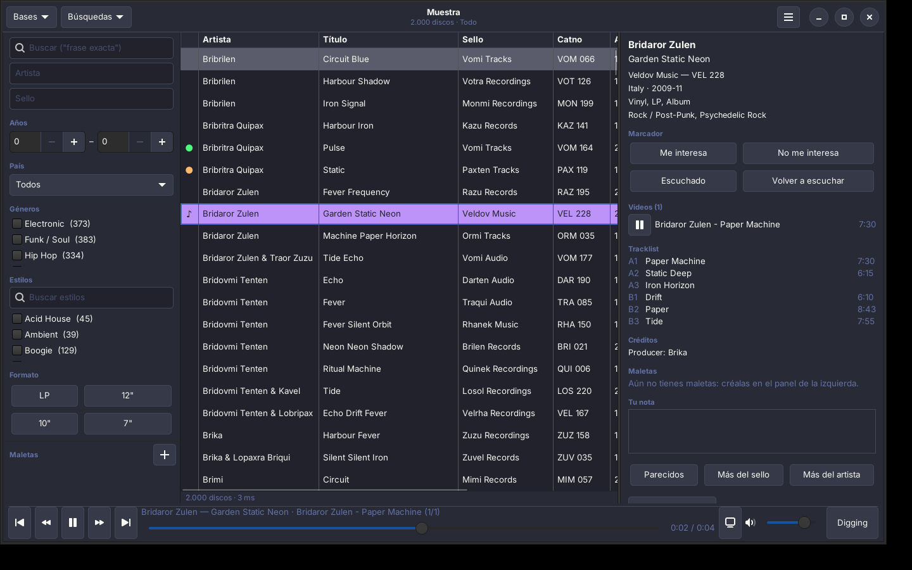

# Manual de usuario de Vault

Vault es un explorador de vinilos: importas el catálogo de Discogs una vez y después buscas,
escuchas y clasificas discos sin conexión con Discogs, solo con YouTube para el audio.

Este manual corresponde a la **versión 1.0**.

## Índice

1. [Antes de empezar](#1-antes-de-empezar)
2. [La ventana](#2-la-ventana)
3. [Importar el dump de Discogs](#3-importar-el-dump-de-discogs)
4. [Bases](#4-bases)
5. [Buscar y filtrar](#5-buscar-y-filtrar)
6. [El detalle de un disco](#6-el-detalle-de-un-disco)
7. [Escuchar](#7-escuchar)
8. [Clasificar: marcadores y modo digging](#8-clasificar-marcadores-y-modo-digging)
9. [Búsquedas guardadas y sesión](#9-búsquedas-guardadas-y-sesión)
10. [Maletas](#10-maletas)
11. [Notas](#11-notas)
12. [La lista: columnas y orden](#12-la-lista-columnas-y-orden)
13. [Ajustes](#13-ajustes)
14. [Atajos de teclado](#14-atajos-de-teclado)
15. [Dónde se guarda cada cosa](#15-dónde-se-guarda-cada-cosa)
16. [Herramientas de terminal](#16-herramientas-de-terminal)
17. [Problemas frecuentes](#17-problemas-frecuentes)

---

## 1. Antes de empezar

**Qué necesitas:**

- Linux con escritorio (probado en Arch con Hyprland).
- **mpv** y **yt-dlp** para escuchar: `sudo pacman -S --needed mpv yt-dlp`.
  Conviene tener yt-dlp al día: YouTube cambia a menudo y un yt-dlp viejo deja de funcionar.
- El dump de releases de Discogs: `discogs_AAAAMMDD_releases.xml.gz`, de
  [data.discogs.com](https://data.discogs.com/). Ocupa unos 10 GB y trae unos 18 millones de
  discos. No hace falta descomprimirlo.
- Espacio en disco para la base (ver [3.4](#34-cuánto-ocupa-y-cuánto-tarda)).

**Qué no hace falta:** cuenta de Discogs, conexión a Discogs ni clave de API. Los dumps no traen
portadas, así que Vault no las muestra.

## 2. La ventana



| Zona | Qué hay |
|---|---|
| Barra de título | **Bases** (importar, abrir, recientes), **Búsquedas** (guardadas), nombre de la base y sus datos, menú de **Ajustes** (☰) |
| Izquierda | Panel de filtros y, debajo, tus **maletas** |
| Centro | La lista de discos y, debajo, la barra de estado: nº de discos, tiempo de la búsqueda y búsqueda guardada activa |
| Derecha | Detalle del disco elegido. El separador se puede arrastrar y Vault recuerda el ancho |
| Abajo | Barra de reproducción y botón **Digging** |

En la columna estrecha de la izquierda de la lista, un **●** de color indica el marcador del
disco y **♪** indica el que está sonando.

## 3. Importar el dump de Discogs

### 3.1 Abrir el diálogo

**Bases → Importar dump…** (o el botón de la pantalla de bienvenida si no hay ninguna base).

### 3.2 Elegir qué entra

| Campo | Qué hace |
|---|---|
| Dump | El `.xml.gz` descargado. También acepta `.xml` descomprimido |
| Nombre | Nombre de la base. Decide también el nombre del archivo (`Tech House 1995` → `tech-house-1995.db`) |
| Preajuste | **Todo en vinilo** (todos los géneros, solo vinilo, sin límite de años) o **Personalizado**. Al tocar cualquier filtro pasa a Personalizado |
| Formato | Vinyl, CD, Cassette, File, Shellac, Box Set. Ninguno marcado = todos |
| Años | Desde – hasta. `0` = sin límite. Con años, los discos sin fecha quedan fuera |
| Géneros y estilos | Árbol: marca un **género entero** o despliégalo (▸) y marca **estilos sueltos** (p. ej. Electronic → Tech House). Nada marcado = todos |
| Se guarda en | Ruta del archivo que se va a crear |

Todos los filtros se combinan: por ejemplo, Electronic + Rock, de 1990 a 2026, solo vinilo.

**Recomendación:** prueba primero con una base pequeña (un solo estilo) para ver cómo va, y
después crea una base principal «Todo en vinilo» y filtra por género y estilo dentro de la app.

### 3.3 Durante la importación

La barra muestra el porcentaje leído, discos leídos e importados, discos por segundo y el tiempo
que queda. **Cancelar** detiene la importación y no deja ninguna base a medias.

Al llegar al 100 % todavía se crean los índices y el buscador: puede tardar uno o dos minutos con
la barra quieta. Al terminar, la base se abre sola.

Una base no se renueva cada mes: se importa una vez y se usa tal cual mucho tiempo. Cuando
termines puedes borrar el dump si no piensas importar con otros filtros.

### 3.4 Cuánto ocupa y cuánto tarda

Medido con un dump real: Electronic, vinilo, 1980–2026 → **1,28 millones de discos, 1,7 GB,
8–10 minutos**. Son unos 1,4 KB por disco con todos los índices. A partir de ahí, de forma
aproximada:

| Base | Discos | Tamaño | Tiempo |
|---|---|---|---|
| Un estilo (prueba) | decenas de miles | decenas a cientos de MB | ~8 min |
| Todo en vinilo | ~6–7 millones | ~9–10 GB | ~12–15 min |
| Todo el dump | ~18,5 millones | ~26 GB | ~20–25 min |

El tiempo mínimo es el de leer el dump entero (unos 8 minutos), filtres lo que filtres. La
importación se escribe en un archivo temporal en la misma carpeta y se renombra al acabar: no
necesitas el doble de espacio.

## 4. Bases

Puedes tener **varias bases** (p. ej. «Todo en vinilo» y «Tech House 1995–2005») y cambiar entre
ellas en **Bases → Recientes**. La que está abierta lleva un ●. Al arrancar, Vault abre la última
que usaste.

**Bases → Abrir base…** abre cualquier `.db` creado por Vault, también en otro disco.

Tus marcadores, notas, maletas y búsquedas guardadas **sirven para todas las bases**: se guardan
aparte y se enlazan por el número de disco de Discogs.

Si una base se creó con una versión de Vault con otro formato, Vault te pedirá importarla de
nuevo. Tus datos no se tocan.

## 5. Buscar y filtrar

Cada cambio en el panel de filtros busca solo, un cuarto de segundo después de dejar de
escribir. La búsqueda va en segundo plano: la ventana nunca se queda congelada.

| Filtro | Cómo funciona |
|---|---|
| Buscar | Texto libre en artista, título, sello, número de catálogo, títulos de pista y **tus notas** |
| Artista / Sello | Solo en ese campo |
| Años | Desde – hasta (`0` = sin límite) |
| País | Lista con el nº de discos de cada país |
| Géneros / Estilos | Varios a la vez: basta con que el disco tenga uno. Los estilos tienen buscador |
| Formato | LP, 12", 10", 7", EP, Single, Album, Compilation (varios = cualquiera) |
| Solo con vídeos | Oculta los discos sin vídeos |
| Marcadores | Solo los discos con alguno de los marcadores elegidos |
| Ocultar «No me interesa» | Quita los descartados |
| Solo sin marcar | Solo lo que aún no has clasificado |
| Maleta | Solo los discos de una maleta |
| Quitar filtros | Vuelve a la base entera |

Entre filtros distintos se suman las condiciones (Tech House **y** 2004–2010 **y** 12").

**Cómo escribir en el buscador:**

- Las palabras sueltas buscan **por el principio**: `kalo axis` encuentra «Kalo Tren – Axis Point».
- Entre comillas, **frase exacta**: `"jeff mills"`.
- No distingue mayúsculas ni acentos: `dia` encuentra «Día».
- **Ctrl+F** lleva al buscador y **Esc** vuelve a la lista.

## 6. El detalle de un disco

Al elegir un disco en la lista, el panel derecho muestra:

- Artista, título, sello y nº de catálogo, país y fecha, formato, géneros y estilos.
- **Marcador**: cuatro botones (ver [8](#8-clasificar-marcadores-y-modo-digging)).
- **Vídeos**: ▶ para escuchar cada uno, con su duración.
- **Tracklist** con duraciones y **créditos** (productor, remezclas…).
- **Maletas**: un botón por maleta para meter o sacar el disco.
- **Tu nota** (ver [11](#11-notas)).
- **Notas de Discogs**.
- **Parecidos** (mismos estilos, ±2 años), **Más del sello** y **Más del artista**: rellenan los
  filtros y buscan.
- **Abrir en Discogs**: la página del disco en el navegador.

## 7. Escuchar

Doble clic o **Intro** en un disco, **Espacio**, o ▶ en un vídeo del detalle. Vault abre mpv por
debajo y reproduce el audio del vídeo de YouTube.

| Control | Qué hace |
|---|---|
| ⏮ / ⏭ (o `,` / `.`) | Vídeo anterior / siguiente **del mismo disco** |
| ⏪ / ⏩ (o ← / →) | −10 / +10 segundos |
| ▶ / ⏸ (o Espacio) | Play / pausa |
| Barra de posición | Arrastra para saltar |
| 🖵 (o V) | Mostrar u ocultar la ventana de vídeo |
| Volumen | Se recuerda entre sesiones |

Al acabar un vídeo pasa al siguiente del disco. Si un vídeo ya no existe en YouTube, la barra de
estado lo dice y salta al siguiente.

**Ventana de vídeo flotante en Hyprland** (clase `vault-video`):

```
windowrulev2 = float, class:^(vault-video)$
windowrulev2 = size 480 270, class:^(vault-video)$
windowrulev2 = move 100%-500 100%-300, class:^(vault-video)$
```

## 8. Clasificar: marcadores y modo digging

### 8.1 Marcadores

| Tecla | Marcador | Color |
|---|---|---|
| 1 | Me interesa | verde |
| 2 | No me interesa | rojo |
| 3 | Escuchado | naranja |
| 4 | Volver a escuchar | azul claro |
| 0 | Quitar marcador | |

Pulsar otra vez la tecla del marcador que ya tiene el disco lo quita. También se puede marcar con
los botones del detalle.

### 8.2 Modo digging

Pensado para escuchar una lista entera **sin tocar el ratón**:

1. Filtra lo que quieras escuchar, por ejemplo Tech House de 2004 a 2010 con
   **Solo sin marcar**.
2. Pulsa **D** (o el botón **Digging**): empieza a sonar el disco elegido, o el primero.
3. Escucha y pulsa **1–4**: el disco queda marcado y **pasa al siguiente**, que empieza a sonar.
4. **N** / **P** pasan al disco siguiente / anterior sin marcar.
5. **D** otra vez sale del modo.

Si un disco no tiene vídeos, digging lo salta.

Con **Solo sin marcar** activado, lo que vas clasificando deja de aparecer la próxima vez, así
que siempre retomas por lo que te queda.

## 9. Búsquedas guardadas y sesión

### 9.1 Guardar una búsqueda con nombre

1. Pon los filtros, por ejemplo Electronic → Tech House, 2004–2010, Solo sin marcar.
2. **Búsquedas → Guardar la búsqueda actual…** y escribe un nombre: «Tech House 04–10».

Para recuperarla, elígela en el menú **Búsquedas**. El menú también permite renombrarlas (✎) y
borrarlas (🗑).

La barra de estado muestra la búsqueda cargada: **«Tech House 04–10» · 23.418 discos**. Si
cambias algún filtro pone **(modificada)**, y en el menú aparece **Guardar cambios en «…»**.

### 9.2 Vuelves donde lo dejaste

Al abrir Vault (o al volver a una base) se restauran los filtros, el orden, la búsqueda guardada
cargada y el disco en el que estabas. No hace falta hacer nada: se guarda solo.

## 10. Maletas

Las maletas son listas tuyas, por ejemplo «Tech House», «Techno» o «Para comprar». Un disco
puede estar en varias.

- **Crear:** botón **+** junto a «Maletas», en el panel izquierdo.
- **Meter un disco:**
  - arrastra el disco desde la lista (columna Artista o Título) hasta la maleta;
  - **Alt+1…9**: mete el disco elegido en la maleta 1…9, en orden alfabético;
  - o usa los botones de maleta del detalle (también para sacarlo).
- **Ver una maleta:** clic en ella o elígela en el filtro **Maleta**.
- **Menú ⋮ de cada maleta:** ver, renombrar, color, **exportar CSV** y borrar. Borrar una maleta
  no borra los discos.

**Exportar CSV:** una fila por disco con `release_id`, artista, título, sello, catno, año, país,
formato, estilos y el enlace de Discogs. Se abre bien en LibreOffice y Excel y sirve para comprar
o para importar a tu wantlist.

## 11. Notas

En el detalle, **Tu nota** es un texto libre por disco («buen B2», «escuchar en la tienda»…). Se
guarda solo al dejar de escribir y **se puede buscar** desde el buscador general.

## 12. La lista: columnas y orden

- **Ordenar:** clic en la cabecera (Artista, Título, Sello, Catno, Año, País). Otro clic invierte
  el orden. Los discos sin año van siempre al final.
- **Ancho:** arrastra el borde de la cabecera. Cada columna se queda en el ancho que le des.
- **Mover:** arrastra la cabecera a otra posición.
- **Ocultar:** **clic derecho en cualquier cabecera** y desmarca las que no quieras, o desde
  **Ajustes → Columnas**.

Vault recuerda el orden, el ancho y qué columnas se ven.

## 13. Ajustes

Menú **☰** de la barra de título:

| Ajuste | Qué hace |
|---|---|
| Tema | Dracula (por defecto), Catppuccin Mocha, Gruvbox Dark, Nord, Tokyo Night, Rosé Pine, Everforest Dark, Kanagawa Wave, Monokai Pro o Ayu Dark. Cambia al instante |
| Sonido | PipeWire (por defecto), PulseAudio o ALSA |
| Dispositivo | Dispositivo de audio concreto (p. ej. `hw:1,0` con ALSA). Vacío = el de por defecto. Pulsa Intro para aplicarlo |
| Vídeo | Mostrar vídeo al reproducir |
| Bases nuevas en | Carpeta donde se crean las bases (por ejemplo, un disco grande de datos) |
| Columnas | Qué columnas se ven |
| Acerca de Vault | Versión, licencia y créditos |

**Memoria:** si la base cabe holgadamente en la RAM libre, Vault la carga en memoria al abrirla,
en segundo plano, y las búsquedas son más rápidas desde el principio. La memoria la gestiona el
sistema: si otro programa la necesita, la recupera.

## 14. Atajos de teclado

| Tecla | Acción |
|---|---|
| Espacio | Play / pausa (si no suena nada, pone el disco elegido) |
| ← / → | −10 s / +10 s |
| `,` / `.` | Vídeo anterior / siguiente del disco |
| 1 · 2 · 3 · 4 | Me interesa · No me interesa · Escuchado · Volver a escuchar (otra vez = quitar) |
| 0 | Quitar el marcador |
| N / P | Disco siguiente / anterior |
| D | Entrar o salir del modo digging |
| V | Mostrar u ocultar el vídeo |
| Alt+1…9 | Meter el disco elegido en la maleta 1…9 |
| Ctrl+F | Ir al buscador |
| Esc | Del buscador a la lista |
| ↑ / ↓, Re Pág / Av Pág, Ctrl+Inicio / Ctrl+Fin | Moverse por la lista |
| Intro / doble clic | Escuchar el disco |

Mientras escribes en un campo de texto, las teclas son para escribir.

## 15. Dónde se guarda cada cosa

| Qué | Dónde | Tamaño |
|---|---|---|
| Bases importadas | `~/.local/share/vault/bases/<nombre>.db` (o la carpeta de Ajustes) | GB |
| Tus datos: marcadores, notas, maletas, búsquedas | `~/.local/share/vault/user.db` | KB–MB |
| Ajustes, recientes, columnas, sesión | `~/.config/vault/config.toml` | KB |

Para hacer copia de seguridad de tu trabajo basta con `user.db` (y `config.toml` si quieres los
ajustes). Las bases se pueden volver a crear desde el dump.

## 16. Herramientas de terminal

Vienen con el PKGBUILD y en `target/release/` al compilar:

```bash
vault-importar discogs_20260101_releases.xml.gz ~/.local/share/vault/bases/tech-house.db \
  --nombre "Tech House" --formato Vinyl --estilo "Electronic/Tech House" --desde 1995 --hasta 2005
```

Opciones de `vault-importar`: `--nombre`, `--formato` (repetible), `--genero` (repetible),
`--estilo "Género/Estilo"` (repetible), `--desde`, `--hasta`.

- `vault-muestra <dump.xml.gz> <salida.xml> [n]`: los primeros n discos de un dump (por defecto
  2000).
- `vault-catalogo <dump.xml.gz>`: lista género → estilo de un dump.

## 17. Problemas frecuentes

**No suena nada / «No se puede reproducir».** Comprueba que están instalados mpv y yt-dlp
(`mpv --version`, `yt-dlp --version`) y actualiza yt-dlp. En Ajustes, prueba otro servidor de
sonido.

**Un vídeo no se reproduce y salta al siguiente.** El vídeo se ha borrado de YouTube o no está
disponible en tu país. Es normal en discos antiguos.

**El AppImage no arranca: «FUSE».** `sudo pacman -S fuse2`, o lánzalo con
`./Vault-x86_64.AppImage --appimage-extract-and-run`.

**«Se importó con una versión anterior de Vault».** Vuelve a importar el dump. Tus marcadores,
notas y maletas se conservan.

**La barra de importación se queda en 100 %.** Está creando los índices: espera uno o dos minutos.

**Ver qué pasa por dentro.** Lanza Vault desde una terminal con `VAULT_LOG=debug vault` (o con el
AppImage) y copia la salida al informar de un problema.
